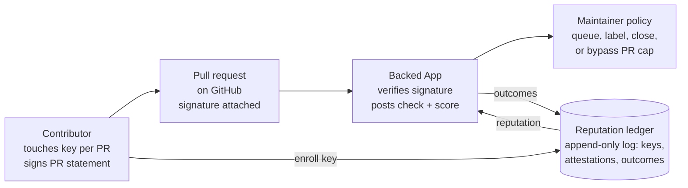
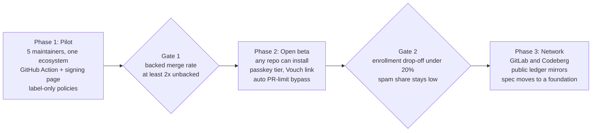

# Design doc: Human-backed contributions for open source

October 30, 2026 · Max · Status: Draft

## Summary

We propose a system that lets a contributor attach a hardware-key signature to each pull request, stating that a real person read the change and stands behind it. Maintainers use that signal, plus the key's track record across projects, to prioritize, throttle or auto-close PRs. Working name: **Backed**.

The system targets one gap in today's defenses against AI-generated PR floods: existing tools key trust to GitHub accounts, which are free to create. A hardware key costs money, caps output at human speed (one touch per PR), and carries reputation across accounts and forges. It does not prove a PR is good, and it does not prove one key equals one person; it raises the cost of low-effort volume and makes repeat offenders visible.

## Background and problem

Generating a PR now costs an agent seconds, while reviewing one still costs a maintainer the same human time. Projects have responded by closing doors: cURL ended its bug bounty in January 2026, Ghostty closes drive-by AI PRs, and tldraw auto-closes all external PRs ([InfoQ](https://infoq.com/news/2026/02/ai-floods-close-projects)).

Current tools:

| Tool | What it does | Where trust lives | Gap |
| --- | --- | --- | --- |
| [GitHub PR access settings](https://www.softwareseni.com/what-github-and-the-oss-ecosystem-are-building-to-protect-maintainers-from-ai-slop) (Feb 2026) | Disable PRs or limit them to collaborators | Collaborator list | Closes the door on newcomers too |
| [GitHub PR limits](https://github.blog/open-source/maintainers/how-pull-request-limits-are-cutting-down-the-noise/) (Jun 2026) | Cap open PRs per user without write access; bypass list | GitHub account | A cap per free account; 50 accounts get 50 caps |
| [Vouch](https://itsfoss.com/news/mitchell-hashimoto-vouch/) (Feb 2026) | Unvouched users can't open PRs; maintainers vouch or denounce | Per-project list of accounts | Manual, per project; newcomers start from zero everywhere |

The shared weakness: trust is attached to accounts, which cost nothing to create and don't carry history across projects. GitHub's own post suggests the next step is clearing limits automatically from signals such as a merged PR or account age. Those signals are cheap to fake at scale. Maintainers have also asked for an honesty layer combined with reputation rather than perfect AI detection ([PyAI panel](https://pydantic.dev/articles/pyai-oss-panel)).

## Goals and non-goals

Goals:

1. Give maintainers a per-PR signal that a person took responsibility for the exact code under review.
2. Make high-volume, low-effort contribution expensive: bounded by human touches and by the cost of fresh identities.
3. Let good contributors carry reputation across projects, accounts and forges, so newcomers to a project aren't strangers.
4. Plug into existing controls (GitHub PR limits, Vouch) rather than replacing them.
5. Keep the contributor's real-world identity out of it: pseudonymous by default.

Non-goals:

- Detecting whether code was written by AI. AI use is self-declared and the signal is responsibility, not origin.
- Judging quality. A backed PR can still be bad; review stays human.
- Proving one key equals one person. The system raises cost; it doesn't guarantee uniqueness.
- Securing the supply chain. Commit signing and build provenance are separate problems.
- Replacing maintainer judgment. Policies are per project and fully optional.

## Proposed design overview

A contributor enrolls a hardware key once, then touches it for every PR. A GitHub App verifies the signature and applies each project's policy, and outcomes flow into a shared ledger that becomes the key's reputation.



The App is the only hosted component maintainers depend on; the ledger is public and the verifier is open source, so any project can recompute reputation without trusting the operator.

## Detailed design

### Enrollment

1. The contributor runs `gh backed enroll`, or opens the enrollment page in a browser, and touches a FIDO2 key. The key creates a dedicated credential for Backed.
2. The registration includes the key's attestation, which the Backed service checks against the FIDO Metadata Service to confirm genuine hardware. Software authenticators are rejected for the full tier (see Inclusion for the weaker tier). This check runs on the service, never in the contributor's browser, since a check the contributor can edit proves nothing. The attested credential public key is the one recorded, so later signatures are tied to the verified hardware.
3. The key signs a binding statement: `{key_id, forge: "github", account_id, issued_at}`. The account proves control by posting the statement's hash to a gist or via OAuth. One key can bind several accounts and forges; reputation sums across them.
4. The key ID and binding are appended to the public ledger.

### Per-PR attestation

When a PR is opened or updated, `gh backed sign` (or a browser flow) asks for a touch and signs:

```json
{
  "v": 1,
  "repo": "owner/name",
  "pr": 1234,
  "head_sha": "9f3c1ad…",
  "statement": "I have read and understand this change and take responsibility for it.",
  "ai_use": "assisted",
  "signed_at": "2026-10-30T09:20:00Z"
}
```

- `ai_use` is one of `none`, `assisted`, `mostly-generated`. Self-declared; the point is honesty on the record, not detection.
- The signature covers `head_sha`. A new push invalidates it until the contributor touches again.
- Format: a WebAuthn assertion whose challenge is `SHA-256(statement JSON)`, with user verification (PIN) required. Browsers, phone passkeys and the CLI (libfido2) all produce this format, so one verifier covers both tiers. The relying-party ID is fixed to one Backed domain and is part of the spec, because an assertion only verifies for the domain it was made on.
- The verifier also checks that the PR author is an account bound to the signing key (Enrollment step 3).
- The Backed GitHub App verifies the signature and posts a check run: `backed: yes`, plus the key's reputation summary.
- The statement text is fixed per version, so maintainers know exactly what was claimed.

### Maintainer policy

Policy lives in `.github/backed.yml`:

```yaml
unbacked: queue          # queue | label | close
backed:
  min_reputation: 0      # floor to count as backed
  bypass_pr_limit: true  # skip GitHub PR caps
  bypass_after_merges: 1 # merged PRs (any project) before bypass applies
vouch:
  accept_key_vouches: true
```

- `queue` adds a label and moves the PR to a slow-review view; `close` auto-closes with a comment explaining how to back it.
- The app manages GitHub's PR-limit bypass list from these rules, so maintainers don't curate it by hand.
- Vouch entries can name a key instead of an account, so a vouch survives account changes.

### Reputation ledger

- An append-only transparency log (Trillian-style) of events: enrollments, attestations, outcomes (merged, closed, closed-as-spam), vouches and denouncements.
- Outcome events are written by the GitHub App when PRs close, and signed by the app's key for that installation.
- Reputation is computed by clients, not stored as a score. The default formula weights merges by project size, decays events older than 12 months, and caps any single project's influence.
- Denouncements count only from projects with an active policy and a minimum maintainer history, and show as a separate field rather than folding into the score.

### Components

| Component | Role | Runs where |
| --- | --- | --- |
| `gh backed` extension | Enrollment, per-PR signing via WebAuthn/libfido2 | Contributor's machine |
| Backed GitHub App | Verifies signatures, posts checks, applies policy, writes outcomes | Hosted service |
| Ledger | Append-only log of keys, attestations, outcomes | Hosted, publicly mirrored |
| Verifier library | Recomputes reputation from the log | Anywhere (open source) |

## Threat model and known limitations

The system defends against cheap volume, not against a determined, funded attacker. Each row is a known way it can be gamed, and what limits the damage.

| Attack | What happens | Mitigation | Residual risk |
| --- | --- | --- | --- |
| Buy many keys | Attestation is batch-level for privacy, so keys can't be linked to one person | Each key starts at zero reputation; policies can require prior merges before bypass | A funded actor can run a few dozen identities |
| Human touch farm | A person sits and touches for an agent fleet | Touches cap rate; low merge rate across projects shows in reputation quickly | Works until reputation catches up, roughly the first few PRs per key |
| Back slop sincerely | A real person vouches for bad code | Closed-as-spam outcomes lower reputation; denouncements visible | First bad PR from a new key still costs review time |
| Reputation farming | Merge trivial PRs into friendly or fake repos | Weight merges by project size and maintainer history; cap per-project influence | Mid-sized collusion rings remain possible |
| Coordinated denouncement | A group denounces someone to ruin their reputation | Denouncements shown separately, weighted, decaying, with appeal | Social harm is possible; needs governance |
| Stolen or lent key | Someone else signs with your key | Key requires touch and PIN; revocation event in the ledger | Lending is undetectable by design |
| Compromised GitHub App | False outcome events written | Outcomes signed per installation; projects can verify independently | Platform trust remains for the hosted app |

Not addressed at all: whether the code is correct, whether AI was really used as declared, and malicious code from a trusted contributor.

## Privacy, inclusion and governance

The biggest non-technical risk is that Backed becomes a gate for people who can afford hardware. GitHub's PR controls have already been called "anti-OSS" for gatekeeping new members ([Visual Studio Magazine](https://visualstudiomagazine.com/articles/2026/06/30/github-extends-contribution-controls-from-prs-to-issues.aspx)), so this design treats inclusion as a requirement.

### Inclusion

- **Two tiers.** Hardware keys are the full tier. Phone passkeys (platform authenticators) are a lighter tier: cheaper to get, shown as a distinct badge, and projects choose whether to treat them as backed.
- **Sponsored keys.** A fund, backed by foundations and companies that benefit from open source, ships keys free to students and contributors in low-income regions.
- **Never mandatory by default.** The default policy is `label`, not `close`. Projects opt into stricter rules.

### Privacy

- No real names, emails or government IDs. A key is a pseudonym.
- The ledger links a key's activity across every participating project. Contributors who want separation can enroll separate keys per ecosystem; the cost is starting reputation from zero in each.
- PR content never enters the ledger: only repo, PR number, commit hash, AI-use declaration and outcome.

### Governance

- The statement text, ledger format and reputation formula are an open specification, versioned in public.
- A small steering group drawn from participating maintainers handles denouncement appeals and formula changes.
- Long term, the ledger and spec should move to a neutral foundation (OpenSSF or similar) so no single company controls the trust layer.

## Alternatives considered

| Alternative | Why not (alone) |
| --- | --- |
| AI-content detection | Unreliable, easy to evade, and penalizes honest AI-assisted work. The useful question is who stands behind a PR, not what wrote it. |
| Identity verification (government ID, KYC) | Strong uniqueness, but excludes pseudonymous contributors, a core open-source norm, and creates a sensitive data store. |
| Account age and activity signals | Free to fake at scale with aged or purchased accounts. Useful as an input to policy, not as the anchor. |
| Paid deposits per PR | Refundable deposits deter spam but exclude people and feel transactional. Could be an optional future policy. |
| Wait for GitHub to build it | Possible, and partly likely. Backed's differentiators are forge neutrality, an open ledger anyone can verify, and reputation that isn't owned by one platform. If GitHub ships a native version, the spec should be designed so it can adopt it. |
| Social vouching only (Vouch) | Works well inside one project; doesn't scale to newcomers or across projects. Backed complements it by making vouches portable. |

## Prototype findings

A spike in this repo (`index.html`, `verify-attestation.js`, `backed-action.js`) tested enrollment and per-PR signing with a YubiKey in Chrome on October 30, 2026:

- A touch plus PIN signs the PR statement, and the assertion verifies with standard WebCrypto and no server.
- Chrome passes the YubiKey's `packed` attestation through unchanged, with its attestation certificate. Browser enrollment is enough for the full hardware tier, so the CLI isn't required to join.
- Current YubiKeys chain through two intermediates to Yubico Attestation Root 1 (older ones chain directly to the U2F root). The verifier walks a chain of any length and bundles Yubico's published roots and intermediates. A real YubiKey enrollment passed every check, including the chain to a Yubico root.
- Phase 1 needs no hosted service. A GitHub Action reads a signature bundle from a PR comment, checks that it names this repo, PR and head commit, verifies it against a keys file in the repo, and sets a `backed` status and label. The keys file stands in for the ledger and stores each key's attestation, so anyone can re-verify it. GitHub Pages serves the signing page, which fixes the relying-party ID to `<owner>.github.io` for the pilot.
- Account binding without OAuth or gists: a key counts for an account only if a merged PR opened by that account (matched on numeric account ID, not login) added the key to the keys file. GitHub has already authenticated the PR author, so this is the cheapest proof that the account consents. A key-signed binding statement (Enrollment step 3) would still guard against a maintainer swapping keys inside a contributor's PR.
- The Action keeps one status comment per PR with a signing link prefilled with repo, PR and head SHA, which removes the copy-the-SHA step that caused the first failed test.
- `pull_request_target` gives fork PRs a write token, which the Action needs for labels and statuses. It's safe only because the Action never checks out the PR's code. The hosted App avoids this constraint, and the pilot has to keep it.

## Rollout, success metrics and open questions

Rollout runs in three phases, and each phase advances only if its gate metric holds.



If Gate 1 fails, backing doesn't predict quality and the project should stop before building the network.

### Success metrics

| Metric | Why it matters | Target to proceed |
| --- | --- | --- |
| Merge rate, backed vs unbacked PRs | The core claim: backing predicts quality | Backed merge rate at least 2x unbacked in pilot repos |
| Maintainer time per PR triaged | The real cost being reduced | Measurable drop reported by pilot maintainers |
| Contributor drop-off at enrollment | Whether the cost excludes people | Under 20% of attempted enrollments abandoned |
| Share of backed PRs later closed as spam | Whether the signal can be gamed cheaply | Stays low as volume grows |

### Open questions

- Does a fixed statement change behavior, or should it ask one question about the diff before signing?
- Should passkeys count as backed by default, or only when a project opts in?
- Who funds sponsored keys, and how are recipients chosen without new gatekeeping?
- How should reputation treat forks and mirrors of the same project?
- Would GitHub or GitLab accept the attestation as a first-class signal, and what format would they need?
- Do Safari and Firefox pass `packed` attestation through for security keys, as Chrome does?
- Pasting the bundle into a comment is still a manual step. Is that acceptable for the pilot, or should Phase 1 wait for `gh backed sign` to post it?
- Should verification use the FIDO Metadata Service for all vendors from the start, or bundled vendor roots (Yubico only, as in the spike) until the pilot?